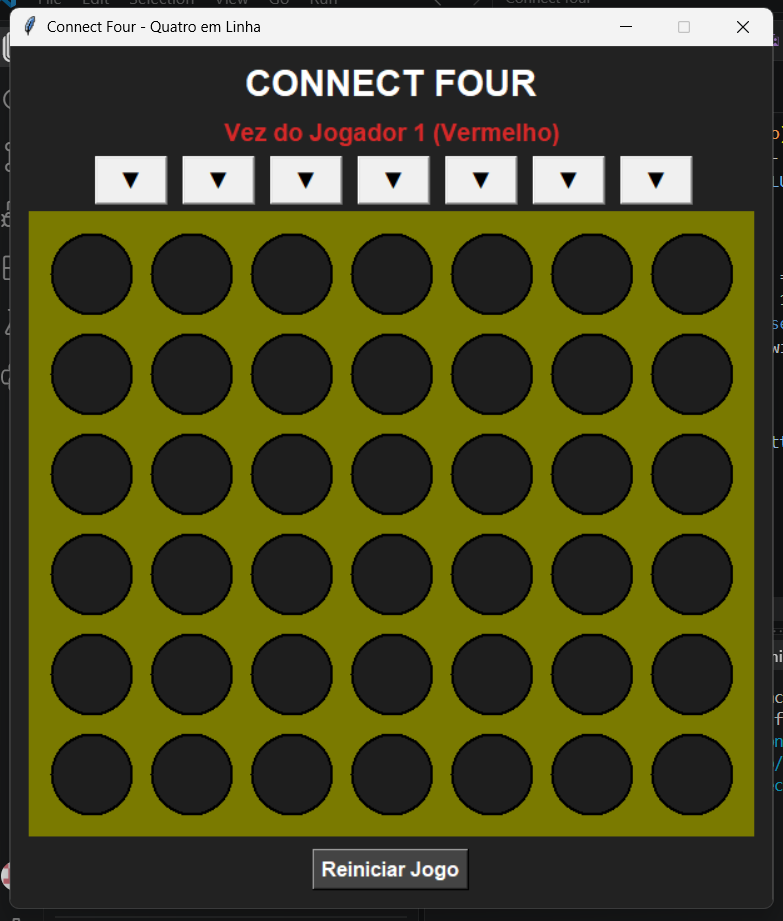
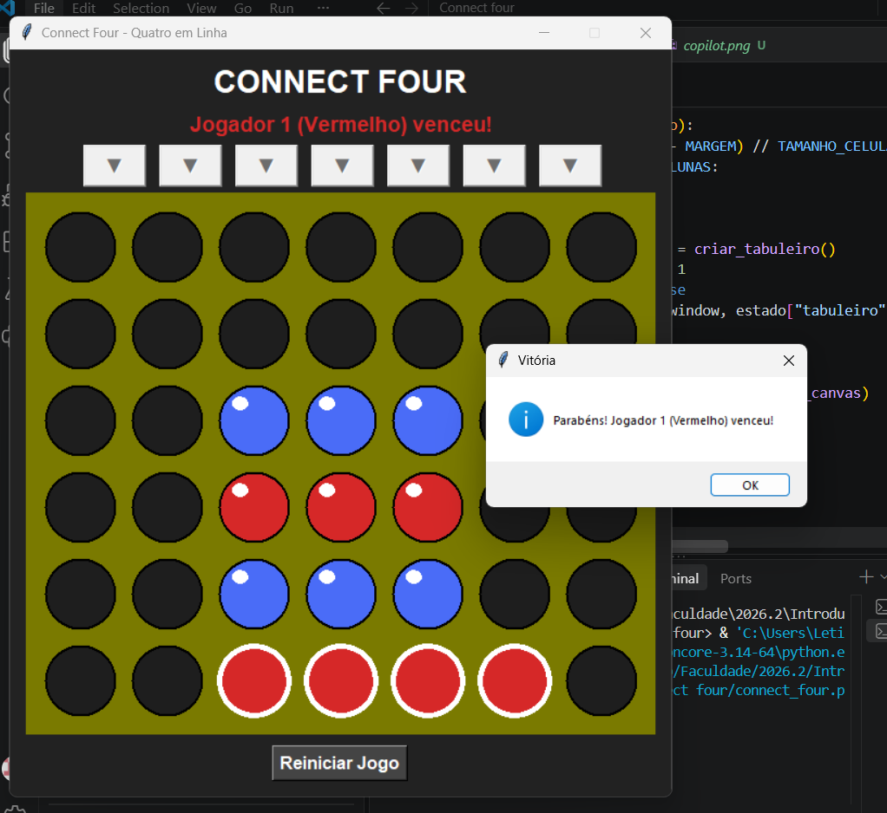
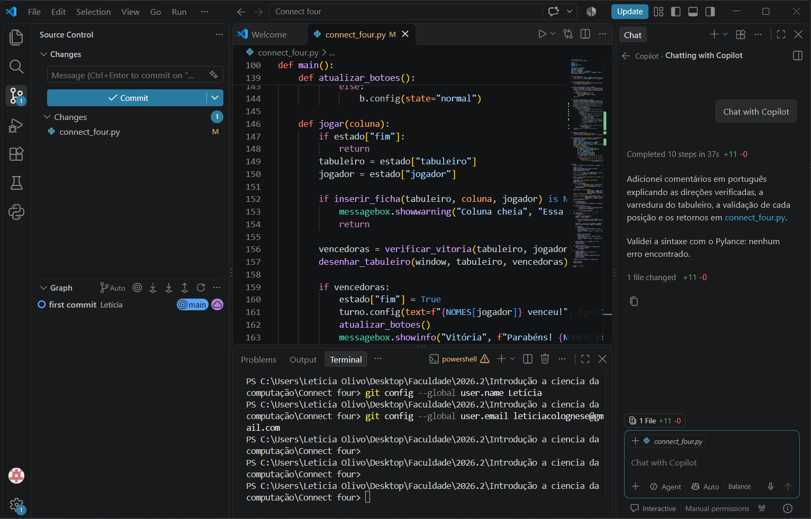
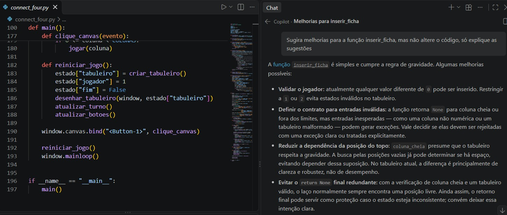

# Connect Four - Quatro em Linha

Tarefa 01 **INE5201 - Introdução à Ciência da Computação com Python** (UFSC).

Jogo Connect Four (Quatro em Linha) para dois jogadores, com interface gráfica feita em **tkinter**. Os jogadores se alternam inserindo fichas em um tabuleiro de 7 colunas por 6 linhas. Vence quem alinhar 4 fichas da mesma cor na horizontal, na vertical ou na diagonal.

## Funcionalidades

- Tabuleiro 7x6 representado por uma matriz (lista 2D)
- Inserção de fichas pelos botões ▼ ou clicando direto na coluna
- Cores diferentes para cada jogador (vermelho e azul)
- Indicador de turno atual
- Gravidade: a ficha cai até a posição mais baixa disponível
- Validação de coluna cheia
- Detecção de vitória em todas as direções, com destaque das 4 fichas vencedoras
- Detecção de empate (tabuleiro cheio)
- Botão "Reiniciar Jogo"

## Como executar

1. Tenha o Python 3 instalado (o tkinter já vem junto com o Python).
2. Baixe ou clone este repositório.
3. Na pasta do projeto, execute:

```
python connect_four.py
```

## Como jogar

- O Jogador 1 (vermelho) começa.
- Clique no botão acima da coluna desejada, ou direto na coluna, para soltar a ficha.
- Os jogadores se alternam até alguém alinhar 4 fichas ou o tabuleiro encher.
- Clique em "Reiniciar Jogo" para começar uma nova partida.

## Estrutura do código

| Função | O que faz |
|---|---|
| `criar_tabuleiro()` | Cria a matriz 6x7 vazia (preenchida com 0) |
| `coluna_cheia(tabuleiro, coluna)` | Verifica se a coluna já está cheia |
| `inserir_ficha(tabuleiro, coluna, jogador)` | Coloca a ficha na posição mais baixa livre da coluna |
| `verificar_vitoria(tabuleiro, jogador)` | Procura 4 fichas em linha (horizontal, vertical e diagonais) |
| `tabuleiro_cheio(tabuleiro)` | Verifica se houve empate |
| `desenhar_tabuleiro(window, tabuleiro)` | Desenha o tabuleiro na tela |
| `main()` | Monta a janela e controla o loop principal do jogo |

## Screenshots

### Início da partida


### Vitória


## Uso do GitHub Copilot

O GitHub Copilot foi usado no VS Code, pelo painel de chat, como assistente de programação.

**Pedido feito ao Copilot:**

> Adicione comentários em português explicando cada parte da função verificar_vitoria

**O que o Copilot fez:** ele colocou comentários na função que confere se alguém ganhou o jogo. Os comentários explicam como o programa procura 4 fichas iguais seguidas, em linha reta, de cima para baixo e na diagonal. Ele também conferiu se o código tinha algum erro, e não encontrou nenhum.

**O que aproveitamos:** lemos os comentários e mantivemos no código, porque ajudaram a gente a entender como o jogo descobre quem venceu.



**Segundo pedido ao Copilot:**

> Sugira melhorias para a função inserir_ficha, mas não altere o código, só explique as sugestões

**O que o Copilot sugeriu:** (escrever aqui, com suas palavras, 1 ou 2 sugestões que ele deu)

**O que achamos:** (escrever se a sugestão faz sentido ou se o código já atende o que a tarefa pede)



## Outras ferramentas de IA

Além do GitHub Copilot, utilizamos o Claude (Anthropic) como na configuração do VS Code, do Git e do GitHub, para a revisão do nosso código e também para entender o quais dados precisam estar no README. O Copilot foi usado para documentar e melhorar partes dele.

## Autoras

- Karoline de Quadros Correia
- Letícia Olivo Colognese